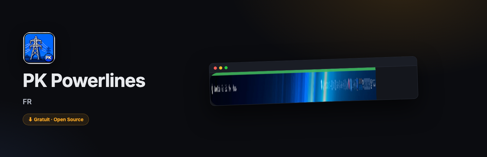
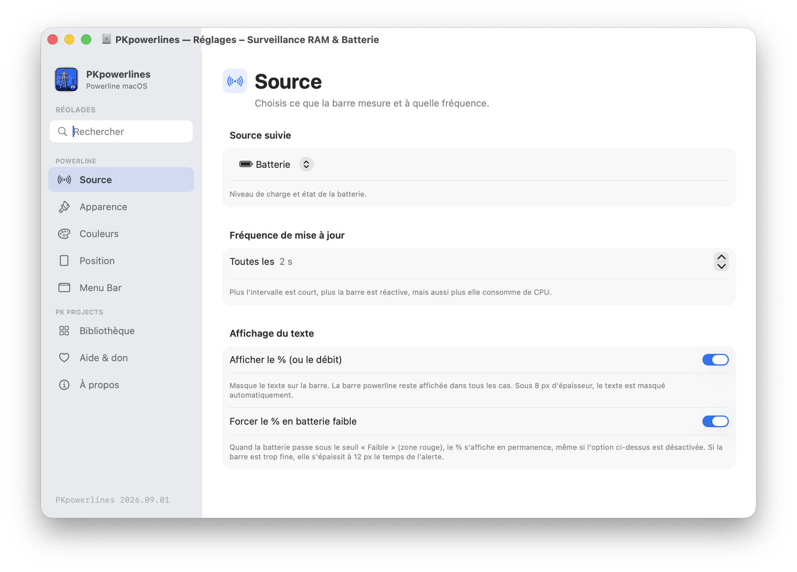
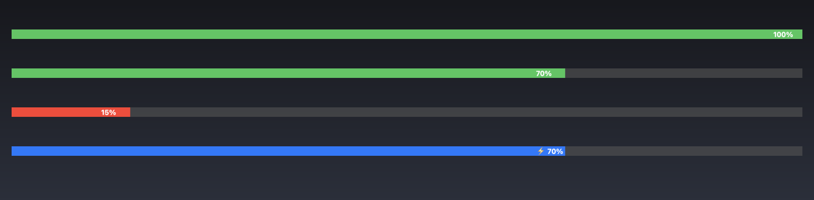

# PKpowerlines



[🇬🇧 EN](README_en.md) · [🇫🇷 FR](README.md)

✨ Native macOS menu-bar app that displays a real-time bar at the top of every screen: RAM or battery. Universal Intel + Apple Silicon binary.

Version **2026.10.10**



## ✅ Features

- 📊 **Four sources** — RAM (active + wired), **CPU** (overall load), **Network** (↓/↑ throughput), Battery (percentage, charging state, dynamic color)
- 🖥️ **Multi-screen** — one bar per screen
- 🧭 **4 edges** — top, bottom, **left**, **right** (vertical bar on the sides)
- 👁️ **% toggle** — show or hide the text (powerline bar always visible)
- 🌌 **Always visible** — every Space, status bar level, click-through
- 🎨 **Contextual colors** — in Source, only the selected source's color is offered (RAM, CPU, Network, or Battery with its low/critical thresholds and 4-state preview)
- 🔤 **Custom font** — 7 fonts, auto-adaptive size, vertically centered percentage
- 🎚️ **Custom height** — slider 4–40px + 4 presets (⌘4/⌘1/⌘2/⌘3)
- 💧 **Opacity** — 20% to 100%
- 🌊 **Animated flow** — subtle fill oscillation, capped at 2 px (3 px while charging), with an off switch
- ⚡ **Charging spark** — an electric light sweep runs along the bar while charging
- 🚨 **Critical battery alert** — below an adjustable critical threshold (15% by default, not charging), the bar pulses like an alert heartbeat
- 🔋 **"Full" state (100%)** — the line becomes extra-extra thin (2 px), the number disappears and a discreet silver shimmer animates it
- 🅰️ **Overflowing text** — the powerline stays at 7 px and flush with the screen edge: the % is drawn at 11 pt **on the line**, lifted above the edge (its top leaves the screen) and overflowing below
- 💨 **Consumption** — while discharging, the bar's edge erodes and a thin wisp of smoke drifts away
- 🎛️ **Per-state and per-source animations** — in Bar: one animation per battery state (charging, discharging, alert), one for level (RAM & CPU) and a dedicated network one — **Data stream** (light packets speeding up with throughput) and **Pulses** (rate proportional to speed). Every option with a live preview that plays even when unselected
- 🖥️ **Previews everywhere** — the real bar previewed in Bar (mock screen: edge, offset, height) and in Source (battery states)
- ↕️ **Offset** — pixel by pixel (can overlap the menu bar, or shift on the sides)
- ⏱️ **Frequency** — refresh every 1–10s
- 🧰 **Menu Bar Spacing** — native menu bar spacing for macOS 26 and earlier (removed by Apple in macOS 27; controls are cleanly disabled)
- 🧩 **Universal binary** — `arm64` + `x86_64`
- 🪟 **SwiftUI settings** — searchable sidebar, card-based source picker with dedicated **Credits**, **Project Library** and **Support** (Ko-fi) pages; Project Library and Credits also open directly from the menu bar icon
- 🔄 **Sparkle updates** — About keeps the Stable/Dev update panel pinned at the bottom, with the check button above the channel selector; the sidebar flags available updates and manual checks refresh the feed
- 💚 **Credited inspiration** — PKpowerlines credits PowerLine: Status bar meters, the Android app that inspired its slim indicators

## 🎨 Battery states



- **Normal** — the bar fills proportionally to the percentage, using the Battery color (green by default)
- **Low** — below the threshold (25% by default, adjustable): Low-battery color (red) and the percentage is forced on, even under 8 px
- **Critical** — below the critical threshold (15% by default, adjustable): the bar pulses like an alert heartbeat, percentage always shown
- **Charging** — charging color (blue), ⚡ prefix, and an electric sweep running along the bar
- Under 16 px, the line stays flush with the edge and the % (11 pt) is drawn on it, lifted above the edge and overflowing below; from 16 px, the text fits inside the bar

## 🧠 Usage

 1. Launch the app → the bar appears at the top.
 2. Click the **PKpowerlines icon** in the menu bar:
    - **Settings…** (⌘,) — change mode, color, position, font
    - **Reposition** (⌘R) — force powerline repositioning (useful after resolution change)
    - Height presets (⌘4 / ⌘1 / ⌘2 / ⌘3)
    - **Support on Ko-fi** — opens the support page
    - **Check for Updates…** and **About PKpowerlines** — direct access to updates and the About page
    - **Quit** (⌘Q)

## ⚙️ Settings

| Setting | Values | Access |
|---|---|---|
| Source | RAM / Battery / CPU / Network | Settings → Powerline |
| Show % | On / Off | Settings → Powerline |
| Force % on low battery | On / Off (default: On) | Settings → Powerline |
| Frequency | 1–10s (default: 10 s) | Settings → Powerline |
| Height | 4–40px | Settings → Powerline (slider) |
| Height presets | 4 / 8 / 12 / 20px | Settings → Powerline or ⌘4/⌘1/⌘2/⌘3 |
| Opacity | 20–100% | Settings → Powerline |
| Font | 16 classics + every installed Nerd Font (auto-detected) | Settings → Bar |
| RAM color | ColorPicker | Settings → Powerline |
| CPU color | ColorPicker | Settings → Powerline |
| Network color | ColorPicker | Settings → Powerline |
| Network ceiling | 1–1000 MB/s | Settings → Powerline |
| Battery color | ColorPicker | Settings → Powerline |
| Low-battery color | ColorPicker + threshold | Settings → Powerline |
| Full (100%) color | ColorPicker | Settings → Powerline |
| Critical threshold | 3–20% (default: 15%) | Settings → Powerline |
| Position | Top / Bottom / Left / Right | Settings → Powerline |
| Offset | -40 to +400px (1px steps) | Settings → Powerline |
| Quit | — | ⌘Q |

## 📦 Install

**Direct download** (universal DMG, Intel + Apple Silicon):
```bash
curl -L -o PKpowerlines.dmg https://github.com/mondary/Macos_PKpowerlines/releases/latest/download/PKpowerlines.dmg
```

**Via Homebrew**:
```bash
brew install --cask mondary/tap/pkpowerlines
```

Or from the [Releases](https://github.com/mondary/Macos_PKpowerlines/releases) page — drag the app to Applications.

## 📦 Build & Package

**Debug build:**
```bash
swift run
```

**Universal release build + `.app` bundle:**
```bash
./build_app.sh
open release/macos/PKpowerlines.app
```

`build_app.sh` compiles as a universal binary (`--arch arm64 --arch x86_64`) and produces `release/macos/PKpowerlines.app`.

**Verify architecture:**
```bash
file release/macos/PKpowerlines.app/Contents/MacOS/PKpowerlines
# → Mach-O universal binary with 2 architectures: [x86_64] [arm64]
```

## 🧪 Stop

```bash
killall PKpowerlines
```

## 🛠️ Development

```
PKpowerlines/
├── src/
│   └── macos/
│       ├── App/
│       │   ├── main.swift              # NSApplication entry point
│       │   └── AppDelegate.swift       # Status bar, bar windows, monitoring
│       ├── Models/
│       │   ├── AppSettings.swift       # ObservableObject (UserDefaults)
│       │   ├── MonitorType.swift       # {.ram, .battery}
│       │   ├── BarPosition.swift       # {.top, .bottom}
│       │   ├── BarFont.swift           # 7 selectable fonts
│       │   └── MenuBarSpacing.swift    # Bar / menu spacing
│       ├── Monitors/
│       │   ├── RAMMonitor.swift        # sysctl/host_statistics64
│       │   ├── CPUMonitor.swift        # host_statistics64 / HOST_CPU_LOAD_INFO
│       │   ├── NetworkMonitor.swift    # getifaddrs delta (↓/↑ KB/s)
│       │   └── BatteryMonitor.swift    # IOKit (IOPMPowerSource)
│       ├── Views/
│       │   ├── PowerBarView.swift             # AppKit bar view
│       │   └── Settings/
│       │       ├── SettingsView.swift         # Root NavigationSplitView
│       │       ├── MenuBarSettingsView.swift  # Menu bar (height, opacity…)
│       │       ├── PowerlineSettingsView.swift# Colors, font, position
│       │       └── AboutSettingsView.swift    # About
│       ├── Resources/
│       │   ├── powerline_black.png / powerline_white.png
│       │   ├── ProjectIcons/                 # PK project icons (Library page)
│       │   └── ProjectScreenshots/           # PK project screenshots (Library page)
│       └── Utils/
│           └── ColorHex.swift          # Color <-> hex
├── store/
│   ├── v1/                               # Store copy + screenshots v1
│   ├── v2/                               # Store landing v2
│   └── website/                          # Pixel-art landing (interactive garden)
├── archives/                             # Old working visuals
├── release/macos/                            # Build output (gitignored)
├── secrets/                                  # Credentials (gitignored)
├── Package.swift                             # SwiftPM (macOS 13+, links IOKit)
├── build_app.sh                              # Universal build + bundle
├── AGENTS.md                                 # Agent instructions
├── LICENSE                                   # MIT
├── README.md / README_en.md
├── CHANGELOG.md                              # Version source of truth
└── icon.png
```

- **Platform**: macOS 13.0+
- **Dependencies**: none (native AppKit + SwiftUI + IOKit)
- **Architectures**: arm64 + x86_64 (universal)
- **Activation**: `LSUIElement` (pure menu-bar, no Dock icon)

## 🧾 Changelog

See [CHANGELOG.md](CHANGELOG.md).

## 🔗 Links

- French README: [README.md](README.md)
- Project landing: [store/website/index.html](store/website/index.html)
- ☕ Support development: [Ko-fi](https://ko-fi.com/pouark)
